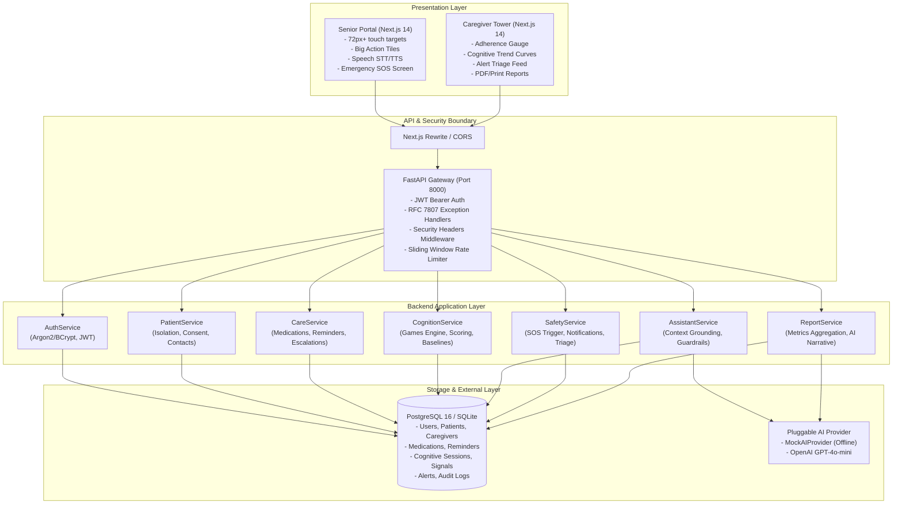
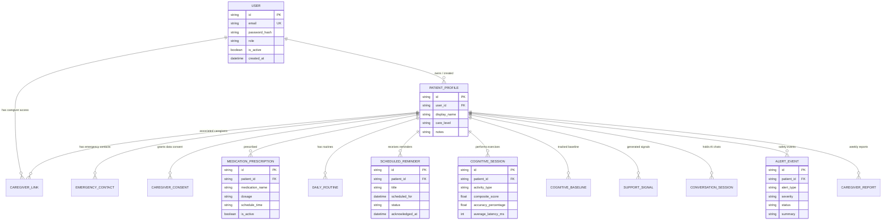

# CogniCare: High-Level Architecture (HLD)

## 1. System Vision & Purpose
CogniCare is an ambient, dual-interface cognitive health and routine care companion designed specifically for aging seniors experiencing mild cognitive impairment (MCI) or early-stage dementia, and their family/professional caregivers.

The system combines:
1. **Senior Ambient Interface**: Ultra-accessible, high-contrast, speech-enabled daily routine and cognitive stimulation station.
2. **Caregiver Control Tower**: Observability dashboard tracking longitudinal cognitive decline, medication adherence, real-time safety alerts, and AI-synthesized clinical reports.
3. **Deterministic Mathematical Scoring Engine**: Zero hallucinations for cognitive performance metrics — strict scoring formulas with baseline drift tracking.
4. **Safety & Policy Guardrails**: Medical policy enforcement strictly prohibiting autonomous clinical diagnoses or prescription alterations.

---

## 2. High-Level Architecture Diagram

---

## 3. Entity-Relationship Data Model

---

## 4. Deployment Topology

Containerized multi-service Docker Compose topology with custom isolated bridge network `cognicare-net`:
1. `cognicare-db`: PostgreSQL 16 Alpine container with health probe.
2. `cognicare-backend`: Multi-stage Python 3.13 image running Uvicorn ASGI server with non-root security.
3. `cognicare-frontend`: Multi-stage Next.js 14 standalone Node.js server.
