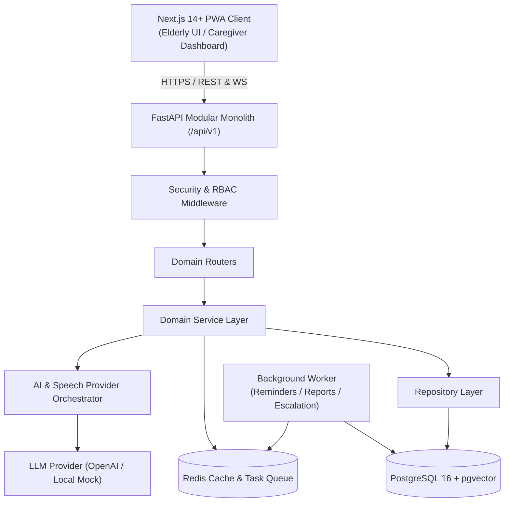

# CogniCare: Architecture Design

## 1. System Topology
The platform is built as a **modular monolith** with clean bounded contexts, exposing a versioned RESTful API (`/api/v1`) and real-time WebSockets.



## 2. Directory Layout (Monorepo)

```text
Capstone/
├── backend/
│   ├── app/
│   │   ├── api/
│   │   │   └── v1/
│   │   │       ├── auth.py
│   │   │       ├── users.py
│   │   │       ├── patients.py
│   │   │       ├── caregivers.py
│   │   │       ├── consents.py
│   │   │       ├── medications.py
│   │   │       ├── routines.py
│   │   │       ├── reminders.py
│   │   │       ├── activities.py
│   │   │       ├── activity_sessions.py
│   │   │       ├── cognition.py
│   │   │       ├── assistant.py
│   │   │       ├── safety.py
│   │   │       ├── notifications.py
│   │   │       ├── reports.py
│   │   │       └── admin.py
│   │   ├── core/
│   │   │   ├── config.py
│   │   │   ├── security.py
│   │   │   ├── database.py
│   │   │   ├── logging.py
│   │   │   └── exceptions.py
│   │   ├── models/           # SQLAlchemy 2.x Declarative Models
│   │   ├── schemas/          # Pydantic v2 Request/Response Models
│   │   ├── repositories/     # Data Access Layer
│   │   ├── services/         # Core Domain Logic
│   │   ├── ai/               # AI & LLM Provider abstractions
│   │   ├── workers/          # Background scheduler / worker tasks
│   │   └── main.py           # FastAPI entrypoint
│   ├── tests/
│   │   ├── conftest.py
│   │   ├── test_auth.py
│   │   ├── test_patients.py
│   │   ├── test_caregivers.py
│   │   ├── test_medications_reminders.py
│   │   ├── test_activities_cognition.py
│   │   ├── test_assistant.py
│   │   ├── test_safety.py
│   │   └── test_reports.py
│   ├── pyproject.toml
│   └── Dockerfile
├── frontend/
│   ├── src/
│   │   ├── app/              # Next.js App Router pages
│   │   │   ├── (auth)/       # Login, Register
│   │   │   ├── (elderly)/    # /app/my-day, /app/assistant, /app/activities, /app/reminders, /app/safety
│   │   │   ├── (caregiver)/  # /caregiver/dashboard, /caregiver/patients, etc.
│   │   │   ├── layout.tsx
│   │   │   └── page.tsx      # Landing page & role router
│   │   ├── components/
│   │   │   ├── ui/           # Accessible design primitives
│   │   │   ├── elderly/      # BigActionButton, VoiceButton, SosButton, ActivityPlayer
│   │   │   └── caregiver/    # TrendChart, AdherenceGauge, AlertFeed, WeeklySummaryCard
│   │   ├── lib/              # axios/fetch client, auth store, utils
│   │   ├── types/            # TypeScript interfaces matching OpenAPI
│   │   └── hooks/            # TanStack Query & custom hooks
│   ├── public/               # manifest.json, service worker, icons
│   ├── package.json
│   ├── tsconfig.json
│   ├── tailwind.config.js
│   └── Dockerfile
├── docker-compose.yml
├── .env.example
└── .env
```

## 3. Communication Patterns
- **Synchronous REST API**: Client performs data modifications and queries over HTTP using JSON payloads with explicit schema validation.
- **Idempotency**: Requests modifying medication adherence, reminder state, and safety alerts support `Idempotency-Key` headers.
- **Background Tasks**: Reminders, alert escalation, trend recomputation, and weekly report generation execute asynchronously.
