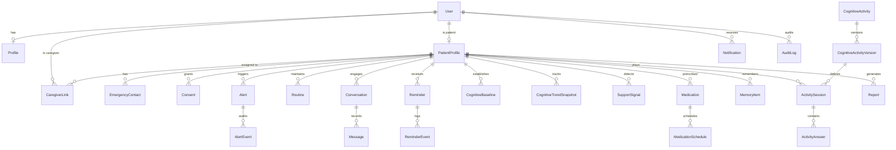

# CogniCare: Data Model (ERD)

## 1. Entity Relationship Diagram

## 2. Table Specifications

### Identity & Access
- `users`: `id` (UUID PK), `email` (VARCHAR UNIQUE), `password_hash` (VARCHAR), `role` (VARCHAR: `ELDERLY`, `CAREGIVER`, `REVIEWER`, `ADMIN`), `status` (VARCHAR), `email_verified_at` (TIMESTAMPTZ NULL), `created_at` (TIMESTAMPTZ), `updated_at` (TIMESTAMPTZ).
- `profiles`: `id` (UUID PK), `user_id` (UUID FK -> users.id UNIQUE), `display_name` (VARCHAR), `phone_number` (VARCHAR NULL), `date_of_birth` (DATE NULL), `preferred_language` (VARCHAR DEFAULT 'en'), `timezone` (VARCHAR DEFAULT 'UTC'), `avatar_url` (VARCHAR NULL), `created_at` (TIMESTAMPTZ), `updated_at` (TIMESTAMPTZ).
- `patient_profiles`: `id` (UUID PK), `user_id` (UUID FK -> users.id UNIQUE), `emergency_notes` (TEXT NULL), `accessibility_preferences` (JSONB), `care_preferences` (JSONB), `created_at` (TIMESTAMPTZ), `updated_at` (TIMESTAMPTZ).
- `caregiver_links`: `id` (UUID PK), `patient_id` (UUID FK -> patient_profiles.id), `caregiver_user_id` (UUID FK -> users.id), `relationship` (VARCHAR), `permissions` (JSONB), `status` (VARCHAR: `PENDING`, `ACTIVE`, `REVOKED`), `created_at` (TIMESTAMPTZ), `revoked_at` (TIMESTAMPTZ NULL).
- `emergency_contacts`: `id` (UUID PK), `patient_id` (UUID FK -> patient_profiles.id), `name` (VARCHAR), `relationship` (VARCHAR), `phone` (VARCHAR), `email` (VARCHAR NULL), `priority` (INT DEFAULT 1), `is_active` (BOOLEAN DEFAULT TRUE), `created_at` (TIMESTAMPTZ).
- `consents`: `id` (UUID PK), `patient_id` (UUID FK -> patient_profiles.id), `purpose` (VARCHAR), `policy_version` (VARCHAR), `granted` (BOOLEAN), `granted_at` (TIMESTAMPTZ), `revoked_at` (TIMESTAMPTZ NULL).

### Care & Reminders
- `medications`: `id` (UUID PK), `patient_id` (UUID FK -> patient_profiles.id), `name` (VARCHAR), `dosage_text` (VARCHAR), `instructions` (TEXT NULL), `active` (BOOLEAN DEFAULT TRUE), `start_date` (DATE NULL), `end_date` (DATE NULL), `created_at` (TIMESTAMPTZ), `updated_at` (TIMESTAMPTZ).
- `medication_schedules`: `id` (UUID PK), `medication_id` (UUID FK -> medications.id ON DELETE CASCADE), `schedule_type` (VARCHAR: `DAILY`, `WEEKLY`, `AS_NEEDED`), `time_of_day` (TIME), `days_of_week` (JSONB NULL), `criticality` (VARCHAR: `NORMAL`, `HIGH`, `CRITICAL`), `active` (BOOLEAN DEFAULT TRUE).
- `routines`: `id` (UUID PK), `patient_id` (UUID FK -> patient_profiles.id), `routine_type` (VARCHAR: `MEAL`, `HYDRATION`, `EXERCISE`, `APPOINTMENT`, `SLEEP`, `CUSTOM`), `title` (VARCHAR), `description` (TEXT NULL), `scheduled_time` (TIME), `recurrence_pattern` (VARCHAR), `active` (BOOLEAN DEFAULT TRUE), `created_at` (TIMESTAMPTZ).
- `reminders`: `id` (UUID PK), `patient_id` (UUID FK -> patient_profiles.id), `source_type` (VARCHAR: `MEDICATION`, `ROUTINE`, `ACTIVITY`, `CUSTOM`), `source_id` (UUID NULL), `title` (VARCHAR), `description` (TEXT NULL), `scheduled_for` (TIMESTAMPTZ), `status` (VARCHAR: `SCHEDULED`, `DELIVERED`, `ACKNOWLEDGED`, `SKIPPED`, `SNOOZED`, `MISSED`, `ESCALATED`, `CANCELLED`), `priority` (VARCHAR: `LOW`, `NORMAL`, `HIGH`, `CRITICAL`), `snooze_until` (TIMESTAMPTZ NULL), `acknowledged_at` (TIMESTAMPTZ NULL), `created_at` (TIMESTAMPTZ).
- `reminder_events`: `id` (UUID PK), `reminder_id` (UUID FK -> reminders.id ON DELETE CASCADE), `event_type` (VARCHAR: `CREATED`, `DELIVERED`, `ACKNOWLEDGED`, `SKIPPED`, `SNOOZED`, `MISSED`, `ESCALATED`), `actor_id` (UUID NULL), `metadata_json` (JSONB NULL), `occurred_at` (TIMESTAMPTZ).

### Cognitive Engine
- `cognitive_activities`: `id` (UUID PK), `activity_type` (VARCHAR: `MEMORY_RECALL`, `WORD_SEQUENCE`, `ATTENTION_STROOP`, `ORIENTATION_MATCH`), `title` (VARCHAR), `category` (VARCHAR), `description` (TEXT), `is_active` (BOOLEAN DEFAULT TRUE), `created_at` (TIMESTAMPTZ).
- `cognitive_activity_versions`: `id` (UUID PK), `activity_id` (UUID FK -> cognitive_activities.id ON DELETE CASCADE), `version_number` (INT), `difficulty` (INT: 1-5), `content_data` (JSONB), `scoring_config` (JSONB), `published_at` (TIMESTAMPTZ).
- `activity_sessions`: `id` (UUID PK), `patient_id` (UUID FK -> patient_profiles.id), `activity_id` (UUID FK -> cognitive_activities.id), `activity_version_id` (UUID FK -> cognitive_activity_versions.id), `status` (VARCHAR: `IN_PROGRESS`, `COMPLETED`, `ABANDONED`), `difficulty` (INT), `total_score` (FLOAT DEFAULT 0.0), `accuracy_rate` (FLOAT DEFAULT 0.0), `avg_response_time_ms` (INT DEFAULT 0), `started_at` (TIMESTAMPTZ), `completed_at` (TIMESTAMPTZ NULL).
- `activity_answers`: `id` (UUID PK), `session_id` (UUID FK -> activity_sessions.id ON DELETE CASCADE), `question_id` (VARCHAR), `user_answer` (JSONB), `is_correct` (BOOLEAN), `response_time_ms` (INT), `attempt_number` (INT DEFAULT 1), `difficulty` (INT), `created_at` (TIMESTAMPTZ).
- `cognitive_baselines`: `id` (UUID PK), `patient_id` (UUID FK -> patient_profiles.id), `metric_name` (VARCHAR), `baseline_value` (FLOAT), `sample_count` (INT), `window_days` (INT DEFAULT 30), `calculated_at` (TIMESTAMPTZ).
- `cognitive_trend_snapshots`: `id` (UUID PK), `patient_id` (UUID FK -> patient_profiles.id), `metric_name` (VARCHAR), `period_start` (DATE), `period_end` (DATE), `current_value` (FLOAT), `baseline_value` (FLOAT), `delta_percent` (FLOAT), `trend_direction` (VARCHAR: `STABLE`, `IMPROVING`, `VARIABLE`, `DECLINING`), `sample_count` (INT), `created_at` (TIMESTAMPTZ).
- `support_signals`: `id` (UUID PK), `patient_id` (UUID FK -> patient_profiles.id), `signal_type` (VARCHAR), `severity` (VARCHAR: `INFO`, `ATTENTION`, `CONCERN`), `description` (TEXT), `evidence` (JSONB), `status` (VARCHAR: `ACTIVE`, `REVIEWED`, `DISMISSED`), `created_at` (TIMESTAMPTZ).

### Assistant, Safety & Platform
- `conversations`: `id` (UUID PK), `patient_id` (UUID FK -> patient_profiles.id), `started_by_user_id` (UUID FK -> users.id), `title` (VARCHAR), `status` (VARCHAR: `ACTIVE`, `ARCHIVED`), `created_at` (TIMESTAMPTZ), `updated_at` (TIMESTAMPTZ).
- `messages`: `id` (UUID PK), `conversation_id` (UUID FK -> conversations.id ON DELETE CASCADE), `role` (VARCHAR: `USER`, `ASSISTANT`, `SYSTEM`, `TOOL`), `content` (TEXT), `content_type` (VARCHAR DEFAULT 'TEXT'), `tool_calls` (JSONB NULL), `created_at` (TIMESTAMPTZ).
- `memory_items`: `id` (UUID PK), `patient_id` (UUID FK -> patient_profiles.id), `memory_type` (VARCHAR: `PREFERENCE`, `ROUTINE`, `PERSONAL_CONTEXT`), `content` (TEXT), `sensitivity` (VARCHAR DEFAULT 'STANDARD'), `is_active` (BOOLEAN DEFAULT TRUE), `created_at` (TIMESTAMPTZ).
- `alerts`: `id` (UUID PK), `patient_id` (UUID FK -> patient_profiles.id), `alert_type` (VARCHAR: `SOS`, `MISSED_MEDICATION`, `INACTIVITY`, `HIGH_RISK_DECLINE`), `severity` (VARCHAR: `LOW`, `MEDIUM`, `HIGH`, `CRITICAL`), `status` (VARCHAR: `OPEN`, `ACKNOWLEDGED`, `ESCALATED`, `RESOLVED`, `FALSE_POSITIVE`), `summary` (VARCHAR), `details` (JSONB NULL), `created_at` (TIMESTAMPTZ), `acknowledged_at` (TIMESTAMPTZ NULL), `resolved_at` (TIMESTAMPTZ NULL).
- `alert_events`: `id` (UUID PK), `alert_id` (UUID FK -> alerts.id ON DELETE CASCADE), `event_type` (VARCHAR), `actor_id` (UUID NULL), `note` (TEXT NULL), `created_at` (TIMESTAMPTZ).
- `notifications`: `id` (UUID PK), `user_id` (UUID FK -> users.id), `title` (VARCHAR), `body` (TEXT), `channel` (VARCHAR: `IN_APP`, `PUSH`, `EMAIL`), `priority` (VARCHAR), `read_at` (TIMESTAMPTZ NULL), `created_at` (TIMESTAMPTZ).
- `reports`: `id` (UUID PK), `patient_id` (UUID FK -> patient_profiles.id), `period_start` (DATE), `period_end` (DATE), `metrics_snapshot` (JSONB), `ai_narrative_summary` (TEXT), `status` (VARCHAR: `DRAFT`, `FINAL`), `created_at` (TIMESTAMPTZ).
- `audit_logs`: `id` (UUID PK), `actor_user_id` (UUID NULL), `patient_id` (UUID NULL), `action` (VARCHAR), `resource_type` (VARCHAR), `resource_id` (VARCHAR NULL), `ip_address` (VARCHAR NULL), `user_agent` (VARCHAR NULL), `details` (JSONB NULL), `created_at` (TIMESTAMPTZ).
