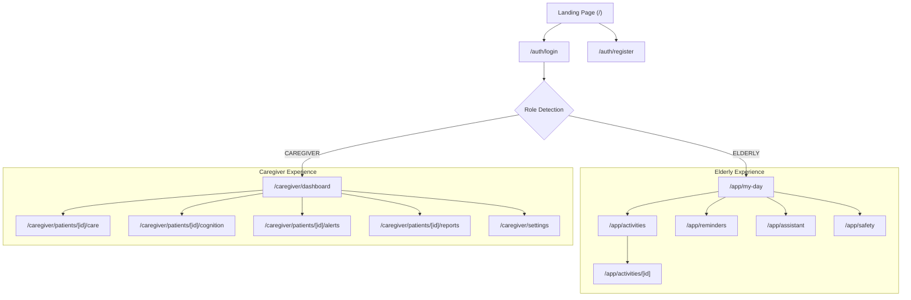

# CogniCare: UI Flows & Screen Architecture

## 1. User Journey & Navigation Map

## 2. Key Screen Specifications

### 2.1 Elderly User Interface (WCAG 2.2 AAA Target)
- **Visual Design Rules**:
  - Minimum font size: 20px (Body: 22px, Headings: 32px-44px).
  - High contrast ratio (>= 7:1) with dark mode / warm cream light mode.
  - Generous touch targets (minimum 64px x 64px button size, minimum 16px padding).
  - Single primary action per viewport card to eliminate choice overload.
  - Icon + Text always paired (e.g. 💊 "Take Morning Pills").
- **Key Screens**:
  1. **`My Day` (`/app/my-day`)**:
     - Large greeting ("Good morning, Margaret").
     - **Hero Card**: "Next Up" with countdown and 1-tap "Done" button.
     - **Action Row**: 🧠 "Play Brain Game" | 💬 "Talk with Assistant" | 🚨 "Call for Help (SOS)".
     - Clean timeline of today's reminders.
  2. **`Cognitive Activity Player` (`/app/activities/[id]`)**:
     - Step-by-step game progression with calm, encouraging feedback.
     - Large choice buttons (e.g. color cards, matching cards).
     - No countdown timers or stressful buzzers; gentle celebration sound/animation upon finish.
  3. **`Assistant Screen` (`/app/assistant`)**:
     - Massive circular microphone button with pulsating speech animation.
     - High-legibility speech bubbles with text-to-speech speaker toggle.
     - Instant quick-prompt chips: "What do I have next?", "Did I take my medicine?", "Tell me a story".
  4. **`Safety & SOS` (`/app/safety`)**:
     - Full-screen high-visibility crimson button: "PRESS FOR HELP".
     - 5-second accidental press cancel timer.
     - Automatic display of primary caregiver name, phone, and emergency contacts.

### 2.2 Caregiver Control Tower
- **Visual Design Rules**:
  - Modern, executive health dashboard (slate/indigo palette, clean card surfaces, subtle gradients).
  - Clear hierarchy: Status Banner -> Urgent Actions -> Adherence & Performance Trends -> Activity Log.
- **Key Screens**:
  1. **`Executive Dashboard` (`/caregiver/dashboard`)**:
     - Multi-patient switcher dropdown.
     - Patient quick-status ribbon (Last active 15m ago | All morning meds taken | No open alerts).
     - **Adherence Ring**: Today's Routine completion rate (e.g. 100%).
     - **Cognitive 30-Day Trend Chart**: Interactive Recharts curve plotting aggregate performance score against baseline.
     - **Urgent Alerts Feed**: Color-coded alert badges with 1-click Acknowledge/Resolve modal.
  2. **`Cognitive Health Deep Dive` (`/caregiver/patients/[id]/cognition`)**:
     - Category breakdown radar/bar chart (Memory, Attention, Sequence, Spatial).
     - Recent session logs with difficulty levels, accuracy rates, and response latency.
     - Longitudinal support signals (e.g. "Response latency in sequence recall slightly elevated over past 14 days").
  3. **`Care & Medication Manager` (`/caregiver/patients/[id]/care`)**:
     - Active prescriptions list with dosage, frequency, and custom reminder instructions.
     - Add Medication / Add Routine drawer form with time pickers.
     - Escalation rules toggle (e.g. "Alert daughter if morning dose unacknowledged by 10:00 AM").
  4. **`Weekly AI Reports` (`/caregiver/patients/[id]/reports`)**:
     - Chronological report history.
     - Structured metrics breakdown (Adherence: 94%, Games completed: 12, Alerts: 0).
     - AI narrative summary explaining week highlights in compassionate plain English.
     - Print / PDF export capability.
