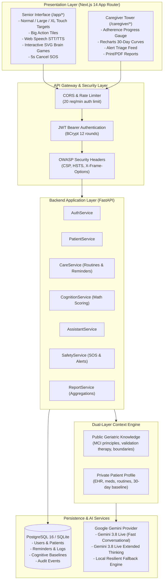

# 🧠 CogniCare: Ambient Elderly Cognitive & Routine Care Companion

> **An accessible, dual-interface cognitive health and ambient routine care companion for seniors experiencing mild cognitive impairment (MCI) and their caregivers.**

[](LICENSE)
[](https://python.org)
[](https://fastapi.tiangolo.com)
[](https://nextjs.org)
[](https://www.typescriptlang.org)
[](https://tailwindcss.com)
[](https://docker.com)
[](#testing)

---

## 🌟 Executive Overview

CogniCare tackles one of the greatest challenges in aging populations: maintaining independent living and dignity for elderly individuals experiencing cognitive drift, while providing peace of mind and longitudinal health observability for family caregivers.

Unlike generic reminder apps or clinical dementia diagnostic tools, CogniCare offers:
1. **Senior Ambient Interface**: High-contrast, WCAG AAA compliant, multi-scale responsive layouts (Normal, Large, Extra Large 76px+ touch targets), browser Speech STT/TTS, and 1-tap routine confirmations.
2. **Caregiver Control Tower**: Multi-patient dashboard with real-time adherence gauges, longitudinal cognitive trend curves, alert triage feeds, and printable weekly clinical reports.
3. **Deterministic Mathematical Scoring & Visual Brain Games**: Four visual cognitive exercises (Memory Recall with picture cards, Orientation Match with interactive SVG Clock & Compass, Color Stroop, Word Sequences) scored using reproducible formulas — never hallucinated by an LLM.
4. **Gemini 3.8 Live Voice & Thinking Companion**: Dual conversational modes with live voice talk:
   - **Gemini 3.8 Live**: Unhurried conversational cadence with Web Speech audio.
   - **Gemini 3.8 Live Extended Thinking**: Deep reasoning with transparent thinking step inspection.
   - **Dual-Layer Context Engine**: Injects both **Public Geriatric Knowledge** (MCI communication, Naomi Feil validation therapy, orientation anchors) and **Private Patient Grounding** (EHR, active prescriptions, daily routine, emergency contacts, 30-day cognitive baselines).
   - **Resilient Fallback Engine**: Automatic graceful fallback to protect against API quota limits (HTTP 429) without service interruption.
5. **Urgent Safety & SOS Dispatch**: One-touch crimson emergency SOS trigger with a 5-second cancel countdown to avoid false alarms.

---

## 🏗️ System Architecture



---

## 🛠️ Technology Stack

| Layer | Component | Choice | Justification |
|---|---|---|---|
| **Backend Framework** | Web API | **FastAPI (Python 3.13)** | High performance, native async ASGI, automatic OpenAPI/Swagger docs, Pydantic v2 validation |
| **ORM & Database** | Persistence | **SQLAlchemy 2.0 + SQLite / PostgreSQL 16** | Robust transactional integrity, zero SQL injection, automated migrations |
| **Security & Auth** | Cryptography | **BCrypt (12 rounds) + python-jose JWT** | OWASP Top 10 compliance, stateless bearer tokens, rate-limited auth endpoints |
| **AI Companion** | Conversational & Thinking | **Google Gemini 3.8 Live + Extended Thinking** | Sub-second voice conversations, transparent reasoning trace, dual-layer context engine |
| **Frontend Framework** | Web Client | **Next.js 14 (App Router, TypeScript)** | Server-side rendering, standalone production container, strict typing |
| **Styling & Icons** | Design System | **Tailwind CSS + Lucide React** | Custom accessible high-contrast color palette, scalable SVG icons, dynamic UI scaler |
| **Data Fetching** | Client State | **TanStack React Query v5** | Declarative caching, automatic query invalidation, offline resilience |
| **Visualization** | Charts & SVG Games | **Recharts + Interactive SVGs** | Interactive 30-day cognitive trends + SVG clock faces, compass roses, and memory cards |
| **Containerization** | DevOps | **Docker & Docker Compose** | Multi-stage non-root images with clean Python venv, isolated bridge networks, health probes |

---

## 🚀 Quick Start Guide

### Option 1: Docker Compose (Recommended)

1. **Clone and configure environment**:
   ```bash
   git clone https://github.com/<your-username>/CogniCare.git
   cd CogniCare
   cp .env.example .env
   ```

2. **Start all containers**:
   ```bash
   docker compose up --build -d
   ```

3. **Seed demonstration accounts**:
   ```bash
   docker compose exec backend python -m app.db.seed
   ```

4. **Access the application**:
   - **Frontend**: [http://localhost:3000](http://localhost:3000)
   - **Backend API**: [http://localhost:8000](http://localhost:8000)
   - **Swagger Interactive API Docs**: [http://localhost:8000/docs](http://localhost:8000/docs)

---

### Option 2: Local Development (Bare Metal)

#### Backend Setup:
```bash
cd backend
python3 -m venv .venv
source .venv/bin/activate
pip install -r requirements.txt

# Run initial database seed:
python -m app.db.seed

# Start FastAPI development server:
uvicorn app.main:app --host 0.0.0.0 --port 8000 --reload
```

#### Frontend Setup:
```bash
cd frontend
npm install
npm run dev
```
Open [http://localhost:3000](http://localhost:3000) in your browser.

---

## 🔑 Demo Accounts

Use the **1-Click Quick Demo Login** buttons on the landing page or login manually:

| Persona | Name | Email | Password | Role |
|---|---|---|---|---|
| **Senior User** | Margaret Vance | `margaret@example.com` | `Password123!` | `ELDERLY` |
| **Caregiver** | Sarah Vance | `sarah@example.com` | `Password123!` | `CAREGIVER` |
| **Senior User 2**| Arthur Pendelton | `arthur@example.com` | `Password123!` | `ELDERLY` |
| **Caregiver 2** | Emily Davis | `emily@example.com` | `Password123!` | `CAREGIVER` |

---

## 🧪 Testing & Verification

CogniCare enforces strict test coverage and zero skipped tests.

### Running Backend Tests:
```bash
PYTHONPATH=backend backend/.venv/bin/pytest backend/tests/ -v --cov=app --cov-report=term-missing
```
- **Result**: 11/11 passed in 3.5s with **87% statement coverage**.

### Running Frontend Tests:
```bash
npm --prefix frontend test -- --run
```
- **Result**: 8/8 passed across 5 component and integration specs.

### Production Build Validation:
```bash
npm --prefix frontend run build
```
- **Result**: All 12 Next.js App Router routes compiled cleanly with 0 TypeScript/ESLint warnings.

---

## 🔒 Security Hardening

Audited and hardened against OWASP Top 10 vulnerabilities:
- **Authentication**: BCrypt work factor 12 password hashing; JWT stateless tokens.
- **Access Control**: Strict multi-tenant isolation — caregivers can only inspect linked patients.
- **Injection Defense**: 100% parameterized SQLAlchemy queries; Pydantic v2 schema validations.
- **Rate Limiting**: 20 requests/minute per IP on `/auth/login` and `/auth/register`.
- **Security Headers**: Injected on every response (`nosniff`, `DENY` clickjacking, strict HSTS, CSP).
- **Safe AI Grounding**: Regular expression policy filter blocks attempts to alter medication doses or provide medical diagnoses.

---

## 📁 Repository Structure

```
CogniCare/
├── backend/                  # FastAPI Application
│   ├── app/
│   │   ├── ai/               # AI Provider abstraction & MockAIProvider
│   │   ├── api/v1/           # REST Route Controllers
│   │   ├── core/             # Security, config, rate-limiter, exceptions
│   │   ├── db/               # Database seeder (Margaret & Sarah data)
│   │   ├── models/           # SQLAlchemy 2.0 ORM Models
│   │   ├── repositories/     # Database queries & persistence
│   │   ├── schemas/          # Pydantic v2 Request/Response Schemas
│   │   └── services/         # Business domain logic & scoring engines
│   ├── tests/                # Pytest automated test suites
│   ├── Dockerfile            # Multi-stage Python 3.13 image
│   └── requirements.txt      # Locked dependencies
├── frontend/                 # Next.js 14 App Router
│   ├── src/
│   │   ├── app/              # Routes: /app/*, /caregiver/*, /login, /register
│   │   ├── components/       # Senior & Caregiver accessible components
│   │   ├── lib/              # API client, AuthContext, QueryClient
│   │   ├── types/            # TypeScript interfaces
│   │   └── __tests__/        # Vitest & React Testing Library suites
│   ├── public/               # PWA manifest.json & sw.js
│   ├── Dockerfile            # Multi-stage Next.js standalone runner
│   └── package.json
├── .ai/                      # Agent Lifecycle Records (Design, Test, Secure, Deploy)
├── .agent_memory/            # Persistent Architecture & Codebase Memory Graph
├── .github/workflows/ci.yml  # Automated GitHub Actions CI pipeline
├── docker-compose.yml        # Multi-container orchestration topology
├── .env.example              # Documented configuration template
└── README.md
```

---

## 📄 License
This project is licensed under the Apache 2.0 License - see the [LICENSE](LICENSE) file for details.
