# CogniCare Architecture & Technical Design

## 1. Architectural Principles

CogniCare was designed around four non-negotiable architectural mandates:

1. **Accessibility-First Design**: Elderly individuals experiencing cognitive decline require ultra-large interaction affordances (72px+ touch targets), high contrast (WCAG AAA), multimodal feedback (voice speech synthesis and recognition), and zero cognitive load.
2. **Deterministic Mathematical Evaluation**: Cognitive health measurements directly influence caregiver peace of mind and clinical conversations. All scoring calculations use mathematically reproducible formulas, never hallucinated by generative models.
3. **Strict Healthcare Policy Guardrails**: The conversational AI assistant must remain a supportive, grounding companion. It must never masquerade as a doctor, offer clinical diagnoses, or adjust medication dosages.
4. **Tenant Isolation & Security-in-Depth**: Strict relationship permissions ensure that only designated caregivers can inspect patient data, with OWASP Top 10 defenses at every layer.

---

## 2. Layered Component Architecture

```mermaid
flowchart TD
    subgraph UI["Next.js 14 Frontend"]
        A["Elderly Companion Portal (/app/*)"]
        B["Caregiver Control Tower (/caregiver/*)"]
    end

    subgraph Middleware["Network & Security"]
        C["Rate Limiter (20 req/min)"]
        D["Security Headers Middleware"]
        E["JWT Auth Dependency"]
    end

    subgraph Controllers["FastAPI Routing Layer"]
        F["Auth Controller"]
        G["Patient Controller"]
        H["Care Controller"]
        I["Cognition Controller"]
        J["Assistant Controller"]
        K["Safety Controller"]
        L["Reports Controller"]
    end

    subgraph Services["Domain Service Layer"]
        M["AuthService"]
        N["PatientService"]
        O["CareService"]
        P["CognitionService"]
        Q["AssistantService"]
        R["SafetyService"]
        S["ReportService"]
    end

    subgraph Repositories["Data Access Layer"]
        T["UserRepository"]
        U["PatientRepository"]
        V["CareRepository"]
        W["CognitionRepository"]
        X["SafetyRepository"]
    end

    subgraph Storage["Database & AI Services"]
        Y[("PostgreSQL 16 / SQLite")]
        Z["Pluggable AI Provider"]
    end

    UI --> Middleware
    Middleware --> Controllers
    Controllers --> Services
    Services --> Repositories
    Repositories --> Storage
    Services --> Storage
```

---

## 3. Cognitive Assessment Scoring Formula

To ensure consistency, each cognitive session is scored deterministically based on accuracy and reaction latency:

$$\text{Composite Score} = \min\left(100.0, \max\left(0.0, \text{Accuracy} \times 0.70 + \text{Speed Bonus} \times 0.30\right)\right)$$

Where:
- $\text{Accuracy} = \frac{\text{Correct Answers}}{\text{Total Questions}} \times 100.0$
- $\text{Speed Bonus} = \max\left(0.0, 100.0 - \frac{\text{Latency (ms)} - \text{Expected Time}}{50.0}\right)$

Baseline scores are tracked across a rolling 30-day window to calculate drift signals.
